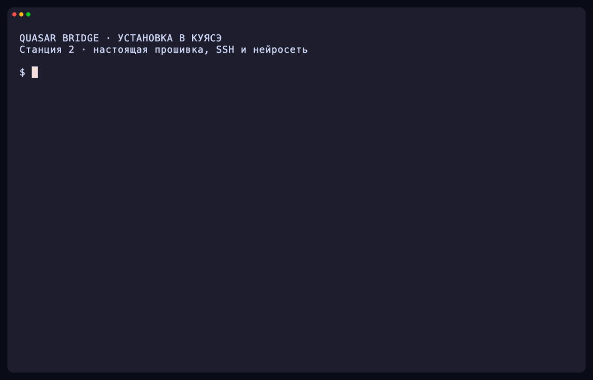
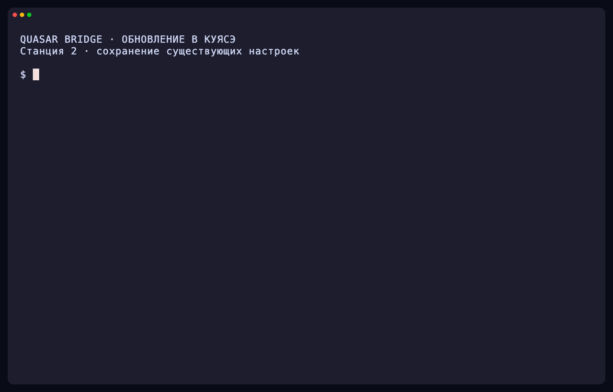

[](LICENSE)
[](go.mod)
[](#что-понадобится)

# Quasar Bridge

Quasar Bridge учит Яндекс Станцию отвечать с помощью вашей собственной
нейросети и управлять умным домом через Home Assistant.

Вы, как и раньше, говорите «Алиса, …». Программа слушает запрос и решает,
кто справится лучше: погоду и таймеры оставляет Яндексу, сложные вопросы отдаёт
нейросети, а команды для света и розеток — Home Assistant. Музыку можно слушать
из Яндекс Музыки и SoundCloud, включая автоматический выбор более подходящего
трека между сервисами.

Интернет при этом нужен: Яндекс по-прежнему распознаёт речь и озвучивает
ответы, в том числе ответы вашей нейросети.

## Как это выглядит

| Вы говорите | Кто отвечает |
| --- | --- |
| «Алиса, включи музыку» | Яндекс; SoundCloud — если выбран провайдером по умолчанию |
| «Алиса, включи песню Гусары орать на Саундклауде» | SoundCloud, если включён |
| «Алиса, включи песню Гусары орать» | При включённом сравнении — сервис с более точным совпадением |
| «Алиса, включи SoundCloud по умолчанию» | Локальная смена музыкального провайдера |
| «Алиса, включи эйрплей» | Встроенный AirPlay-приёмник |
| «Алиса, какая завтра погода?» | Яндекс |
| «Алиса, спроси нейросеть: почему небо голубое?» | Ваша нейросеть |
| «Алиса, сравни варианты утепления балкона» | Ваша нейросеть |
| «Алиса, спроси нейросеть» — сразу после ответа Алисы | Нейросеть ответит на тот же вопрос заново |
| «Алиса, выключи свет в кабинете» | Home Assistant |
| «Алиса, горит ли свет в кабинете?» | Home Assistant |

Ещё несколько приятных мелочей:

- **Нейросеть помнит разговор.** Можно задавать уточняющие вопросы,
  а «Алиса, начни новый разговор» стирает память.
- **После ответа нейросети не нужно снова звать Алису** — колонка сама
  слушает следующий вопрос.
- **Если Алиса не знает ответа**, вопрос может перейти к нейросети,
  пока Яндекс ещё не начал отвечать.
- **Правила можно менять.** Вы сами решаете, какие фразы отправлять
  нейросети, Home Assistant или Яндексу.

## Что понадобится

- **Яндекс Станция с root-доступом по SSH.** Получить root нужно заранее —
  Quasar Bridge этого не делает.
- **Нейросеть с API, совместимым с OpenAI.** Подойдёт модель на вашем сервере
  или у любого провайдера. Понадобятся адрес API и, если сервис его требует,
  ключ. Установщик загрузит доступные модели и предложит выбрать одну из списка.
  Можно также [использовать подписку ChatGPT/Codex](docs/guide.md#подписка-chatgptcodex)
  через вход в ChatGPT, без ключа API. Саму модель Quasar Bridge не устанавливает.
- **Компьютер с `curl` и `ssh`.** В macOS и Linux всё уже есть, в Windows
  подойдёт WSL.
- **Home Assistant** — только если хотите управлять умным домом.

### На каких колонках проверено

| Колонка | Система |
| --- | --- |
| Станция 2 | Linux 4.9, BusyBox 1.31 |
| Станция Миди, в том числе сразу после получения root | Linux 5.4, BusyBox 1.36 |
| Станция Лайт | Linux 4.9, aarch64 |

На Станции 2 и Миди проверены установка, обновление и автозапуск после
перезагрузки, на Станции Лайт подтверждена работа.
Есть и сборка для 32-битных колонок (ARMv7), но конкретные модели
на ней не проверялись — после установки обязательно проверьте голосовые ответы.

### Демонстрации установки

В роликах установщик работает по SSH с эмулятором Станции 2
[КУЯСЭ](https://github.com/vypivshiy/kuyase). Он скачивает настоящий выпуск,
проверяет контрольные суммы, получает модели от нейросети и запускает Bridge
в гостевой прошивке. Перезагрузка отложена в конце установки.

<details>
<summary>Установка через API на Станцию 2 в КУЯСЭ</summary>



</details>

## Установка

Программа ставится прямо на колонку. На самой колонке ничего дополнительно
устанавливать не нужно — хватает стандартных утилит прошивки.

**На компьютере** выполните команду, подставив адрес колонки вместо `SPEAKER_IP`:

```sh
curl -fsSL -o /tmp/install-quasar-bridge.sh https://github.com/skrashevich/quasar-bridge/releases/latest/download/install.sh && sh /tmp/install-quasar-bridge.sh root@SPEAKER_IP -p 2222
```

Если SSH на колонке слушает другой порт, замените `2222`.

Для установки или обновления из [PR #30](https://github.com/skrashevich/quasar-bridge/pull/30):

```sh
curl -fsSL -o /tmp/install-quasar-bridge.sh https://raw.githubusercontent.com/skrashevich/quasar-bridge/refs/pull/30/head/install.sh && sh /tmp/install-quasar-bridge.sh --pr 30 root@SPEAKER_IP -p 2222
```

На компьютере нужны `curl`, SSH и `unzip`; Go и Python не нужны. Установщик
получает сведения о текущем коммите PR через GitHub API и скачивает готовый
архив нужной архитектуры из GitHub Actions через [nightly.link](https://nightly.link/)
без входа в GitHub. Требуется успешно завершённая проверка текущего коммита PR
и доступный артефакт; сборка старого коммита или релиз вместо него не ставится.
При обновлении Enter сохраняет существующие настройки.

Установщик скачает выбранную сборку, сверит контрольную сумму, передаст
файлы на колонку и задаст несколько вопросов:

1. Адрес API нейросети (заканчивается на `/v1`) или `chatgpt` для подписки ChatGPT/Codex.
2. Ключ API — если не нужен, просто нажмите Enter. Ввод скрыт. Для `chatgpt` этот шаг пропускается.
3. Тип API: Chat Completions (подходит почти всем) или Responses. Для `chatgpt` он выбирается автоматически.
4. Номер модели из списка, загруженного через API. Для `chatgpt` перед этим потребуется вход в браузере.
5. Секретная ссылка на Home Assistant MCP — Enter, если умный дом не нужен.
   Ввод виден, чтобы можно было проверить и исправить адрес.
6. Режим SoundCloud: отключить, использовать по явной команде, сделать провайдером
   по умолчанию или сравнивать конкретные песни с выбором Алисы из Яндекса.
   При сравнении можно выбрать провайдера, который побеждает при равных оценках.
   Enter сохраняет существующие настройки; при новой установке SoundCloud отключён.
   Пункт `6` подключает личный аккаунт через `oauth_token` из браузера, пункт `7`
   отключает его. Ввод токена скрыт; аккаунт проверяется перед сохранением.

Для Chat Completions установщик автоматически подберёт совместимые параметры
запросов, если API отклоняет стандартные. При ошибках он покажет полный ответ
LLM-сервера и сохранит рабочие параметры для следующих запусков.

Затем он проверит, что нейросеть отвечает, предложит переключить Алису
на Quasar Bridge и перезагрузить колонку. Если что-то введено с ошибкой,
можно сразу исправить ответы. Автозапуск после перезагрузки настраивается
автоматически.

Для `chatgpt` установщик предложит войти в браузере. На компьютере нужно
открыть SSH-туннель для обратного вызова входа — готовую команду с адресом
колонки и портом установщик покажет сам. Дополнительные команды и ограничения режима
описаны в [инструкции подключения подписки](docs/guide.md#подписка-chatgptcodex).
Если список моделей получить не удалось или он пуст, установщик предложит
повторить настройку подключения либо отменить установку.

[Исходники роликов и команды перезаписи через VHS](scripts/vhs/README.md).

### Проверьте, что всё работает

Скажите колонке:

- «Алиса, какая завтра погода?» — должен ответить Яндекс;
- «Алиса, спроси нейросеть: почему небо голубое?» — должна ответить ваша модель.

Если оба ответа прозвучали — готово.

Программа живёт в `/data/opt/quasar-bridge/app`, а настройки —
в `/data/opt/quasar-bridge` (`config.json` и `runtime.env`).

## Обновление

Запустите ту же команду установки ещё раз. На вопрос об изменении настроек
нажмите Enter — всё сохранится. Установщик заменит программу, проверит,
что новая версия запустилась, а при ошибке вернёт прежнюю. Если Алиса уже
подключена к Quasar Bridge, перезагружать колонку не нужно.
При изменении подключения к нейросети URL Home Assistant сохраняется
и повторно не запрашивается.

<details>
<summary>Демонстрация обновления с сохранением настроек</summary>



</details>

Обновляться можно и голосом — об этом ниже, в разделе
[«Дополнительные возможности»](#дополнительные-возможности).

## Подключение Home Assistant

Этот шаг нужен только для управления умным домом. Без Home Assistant
команды вроде «включи свет» по-прежнему выполняет Яндекс.

1. Установите MCP-сервер [ha-mcp](https://github.com/homeassistant-ai/ha-mcp)
   и включите доступ по секретной ссылке. Встроенный MCP-сервер Home Assistant
   не подойдёт: у него другой набор команд.
2. В Home Assistant откройте нужные устройства для **Assist** и проверьте,
   что у них понятные названия и указаны комнаты.
3. Укажите секретную ссылку. Проще всего — запустить команду установки ещё раз,
   ответить «y» на вопрос об изменении настроек и заново пройти все вопросы.
   Либо на колонке откройте `/data/opt/quasar-bridge/runtime.env`, впишите
   ссылку в строку `QUASAR_HOME_MCP_URL="..."` (символы `$`, `"` и `` ` ``
   экранируйте обратной косой чертой) и перезапустите программу:
   `sh /data/opt/quasar-bridge/app/control.sh restart`.

Попробуйте: «Алиса, горит ли свет в кабинете?» (подставьте свою комнату),
а потом включите и выключите одно устройство и убедитесь, что Home Assistant
это увидел.

Если Home Assistant недоступен, Алиса скажет об ошибке. Команда не будет
повторно отправлена Яндексу — устройство могло уже сработать, поэтому сначала
проверьте его состояние.

[Подробнее о настройке и требованиях к MCP-серверу](docs/guide.md#home-assistant-mcp).

## SoundCloud и выбор музыкального сервиса

Bridge обслуживает штатную музыкальную очередь SoundCloud через UniProxy:
подготавливает следующий трек по запросу колонки и передаёт его для запуска
после текущего, обрабатывает события плеера и команды продолжения/переключения.
Название, исполнитель, длительность, обложка и соседние треки передаются
нативному плееру вместе. Очередь не сохраняется при перезапуске Bridge.

SoundCloud поддерживает поиск треков, исполнителей и плейлистов, публичные ссылки,
обложки, сведения о текущем треке и очередь. Воспроизведение идёт через штатный
плеер колонки; работают пауза, продолжение, следующий/предыдущий трек и перемотка.
Для публичного каталога аккаунт и OAuth-токен не нужны. Функция полностью
реализована на Go и включается отдельно в установщике или в конфигурации.

Можно подключить свою учётную запись без регистрации приложения SoundCloud:
установщик принимает `oauth_token` своей браузерной сессии. После входа доступны
лайки/избранное, загруженные треки, свои и сохранённые плейлисты. Сессия хранится
отдельным закрытым файлом; статус и выход доступны через `-soundcloud-auth`.
[Как подключить аккаунт](docs/soundcloud.md#личный-аккаунт-без-регистрации-приложения).

Если SoundCloud недоступен из сети колонки, для него можно указать отдельный
SOCKS5-прокси в `soundcloud.proxy_url` или `QUASAR_SOUNDCLOUD_PROXY_URL`.
Мастер установки проверяет доступ с колонки и при ошибке предлагает ввести
прокси; сохраняет его только после успешной проверки SoundCloud через него.
Через него идут поиск, авторизация, обложки и аудио; подключения остальных
сервисов сохраняют прежние настройки. Прокси может требовать логин и пароль.
Подробнее — [настройка SOCKS5](docs/soundcloud.md#socks5-прокси).

Примеры команд:

- «Алиса, включи песню Гусары орать на Саундклауде».
- «Алиса, найди на SoundCloud Daft Punk» — результаты без запуска музыки.
- «Алиса, включи мои лайки на SoundCloud» — после входа в аккаунт.
- «Алиса, включи мой плейлист Осень на SoundCloud» — из своей библиотеки.
- «Алиса, что сейчас играет?».
- «Алиса, включи SoundCloud по умолчанию».
- «Алиса, верни Яндекс Музыку по умолчанию».
- «Алиса, какой музыкальный сервис по умолчанию?».

Провайдер по умолчанию переключается голосом сразу и сохраняется после
перезапуска. Для этих команд не нужны инструменты нейросети. Явное указание
сервиса имеет приоритет.

При включённом `soundcloud.compare_yandex` запрос конкретной песни без указания
сервиса одновременно отправляется Алисе и в поиск SoundCloud. Bridge сравнивает
один выбранный Алисой трек Яндекса с лучшим доступным кандидатом SoundCloud по
названию, исполнителю и обозначению версии. Более точное совпадение побеждает;
провайдер по умолчанию используется при равенстве. Ожидание ограничено тремя
секундами, после выбора запускается один трек. Общие запросы музыки, плейлисты и
явные команды сервису сохраняют обычную маршрутизацию.

Ниже пример блока для сравнения с предпочтением SoundCloud при равенстве.
Добавьте его в `/data/opt/quasar-bridge/config.json` и перезапустите Bridge:

```json
"soundcloud": {
  "enabled": true,
  "api": "web",
  "default": true,
  "compare_yandex": true,
  "queue_limit": 50
}
```

Такой пример рассчитан на штатную установку Bridge на колонке со слушателем
loopback без TLS. Для внешнего адреса, HTTPS и показа обложек на телефоне нужен
доступный `base_url`. Веб-интерфейс SoundCloud может меняться; доступ к закрытым
записям зависит от разрешений аккаунта, недоступные полные потоки пропускаются.
При запросе CAPTCHA изменения лайков отклоняются с объяснением; успех не имитируется.

[Настройка, точные критерии и баллы сравнения, ограничения и результаты проверок](docs/soundcloud.md).

## AirPlay

Скажите «Алиса, включи эйрплей», затем выберите колонку в списке AirPlay
на телефоне или компьютере в той же сети. «Алиса, выключи эйрплей»
останавливает приёмник, а «Алиса, статус эйрплей» проверяет его состояние.
После успешного включения AirPlay колонка произносит ответ и завершает
ожидание следующей команды, в том числе при запуске через инструмент нейросети.
Пока подключён отправитель, «пауза», «продолжи музыку», «стоп»,
«громче», «тише» и «громкость 5» управляют AirPlay. Переключение треков
зависит от поддержки удалённых команд отправителем.

В режиме `hybrid` эта функция доступна без дополнительных настроек:
приёмник запускается только по команде и после перезапуска Bridge снова
выключен. Для этих команд не нужны нейросеть, Home Assistant или инструменты;
распознавание и озвучивание по-прежнему выполняет Яндекс.
PCM-проигрыватель из `station-airplay` встроен в сам бинарник Bridge.
Для установки и обновления достаточно одного `quasar-bridge`; отдельный
проигрыватель или системный `aplay` устанавливать не нужно.
Для вывода звука используются штатная ALSA-библиотека и аудиоконфигурация колонки.
Нужен доступ колонки к локальной сети.

При `assistant_tools.enabled: true` нейросеть также получает инструменты
AirPlay: может проверить состояние, включить или выключить приёмник,
поставить воспроизведение на паузу, продолжить его, переключить трек
и изменить громкость. Например: «Алиса, спроси нейросеть, подключён ли
сейчас кто-нибудь по AirPlay». 
## Дополнительные возможности

Настройки Bridge можно менять голосом при включённых инструментах нейросети:
«Алиса, включи журнал диалогов квазар бридж», «Алиса, установи время хранения
контекста квазар бридж десять минут», «Алиса, перезапусти квазар бридж».
Изменения проверяются и сохраняются с резервной копией; настройки, которым нужен
перезапуск, применяются после отдельной явной команды. Перезапуск голосом
доступен для штатной установки на колонке.
[Подробнее о настройках голосом](docs/guide.md#настройки-голосом).

Сразу после установки работают ответы нейросети, память разговора и, если
вы его подключили, умный дом. Остальное включается
в `/data/opt/quasar-bridge/config.json`.

Большинство функций ниже — это «инструменты», которыми нейросеть пользуется
сама. Чтобы их включить, добавьте в `config.json` блок (часовой пояс укажите свой;
не забудьте запятую после предыдущей настройки):

```json
"assistant_tools": {
  "enabled": true,
  "timezone": "Europe/Moscow"
}
```

и перезапустите программу:

```sh
sh /data/opt/quasar-bridge/app/control.sh restart
```

Модель должна уметь вызывать функции (function calling) — большинство
современных моделей это умеют.

| Что можно | Пример | Подробности |
| --- | --- | --- |
| Читать веб-страницы | «Алиса, прочитай страницу https://example.org и перескажи» | [Инструменты](docs/guide.md#инструменты-локальной-llm) |
| Проверять и ставить обновления | «Алиса, проверь обновления», «Алиса, установи обновления» | [Обновления](docs/guide.md#проверка-и-установка-обновлений) |
| Искать в истории разговоров | «Алиса, найди в истории, что я спрашивал про свет». Нужно ещё включить журнал разговоров (`conversation_log`) | [Журнал](docs/guide.md#журнал-запросов-и-ответов) |
| Включать звуки и аудио по ссылке | «Алиса, спроси нейросеть: воспроизведи сигнал уведомления». Нужно добавить в блок `"play_sound": true` | [Звуки](docs/guide.md#звуки-на-колонке) |
| Включать музыку с сайта | «Алиса, включи музыку с сайта example.org/music» — дальше работают «следующий трек», «пауза», «стоп». Тоже нужен `"play_sound": true` | [Звуки и музыка](docs/guide.md#звуки-на-колонке) |
| Искать в интернете и подключать другие сервисы | Через сторонние MCP-серверы | [Свои MCP-серверы](docs/guide.md#свои-mcp-серверы) |
| Настраивать, что куда отправлять | Свои фразы для нейросети, Home Assistant и Яндекса | [Правила](docs/guide.md#правила-маршрутизации) |

Учтите, что «прочитать страницу» и «поискать в интернете» — разные вещи:
первое работает из коробки, для второго нужен отдельный поисковый сервис.
Страницы, требующие входа или JavaScript, могут не открыться.

### О приватности

- Тексты разговоров по умолчанию **не сохраняются** на диск.
- Память разговора хранится в оперативной памяти и стирается при перезапуске.
- Если включить журнал, нейросеть сможет читать из него записи, когда вы
  спрашиваете про историю.
- Память у колонки общая: она не различает, кто именно с ней говорит.

## Если что-то не работает

Подключитесь к колонке по SSH и посмотрите, что происходит:

```sh
pkg=/data/opt/quasar-bridge/app
sh "$pkg/control.sh" status          # запущена ли программа
sh "$pkg/control.sh" logs            # последние строки журнала
sh "$pkg/control.sh" check           # корректны ли настройки
sh "$pkg/control.sh" check-backends  # доступны ли нейросеть и Home Assistant
```

| Что случилось | Что проверить |
| --- | --- |
| Алиса отвечает как обычно, нейросеть не включается | Согласились ли вы подключить Алису в конце установки и перезагрузили ли колонку? Если нет — выполните `sh "$pkg/control.sh" apply` и `reboot` |
| Проверка нейросети не проходит | Адрес API (с `/v1`), название модели, ключ и доступ к API с колонки. При ошибке HTTP 400 проверьте точное название модели и [совместимость API](docs/guide.md#api-llm) |
| Home Assistant в проверке показан как `disabled` | Ссылка на MCP не задана. Если умный дом не нужен — всё в порядке |
| Устройство не находится | Открыто ли оно для Assist? Совпадают ли названия устройства и комнаты с тем, что вы говорите? |
| После перезагрузки Алиса замолчала | Есть ли файл `/etc/init.d/S96quasar-bridge`? Если быстро разобраться не получается, [верните Алису как было](#как-вернуть-всё-как-было) |

После изменения адреса, ключа или модели программу нужно перезапустить:
`sh "$pkg/control.sh" restart`.

Не получается разобраться — создайте
[issue](https://github.com/skrashevich/quasar-bridge/issues). Укажите модель
колонки, версию программы (файл `/data/opt/quasar-bridge/app/VERSION`), на каком шаге возникла проблема и текст ошибки.
Ключи API и секретные ссылки из `runtime.env` не публикуйте.

## Как вернуть всё как было

Если Bridge ещё работает в режиме `hybrid`, можно сказать: «Алиса, переведи
квазар бридж в режим наблюдения» — запросы будут идти в Яндекс через Bridge
после его перезапуска. Команда «Алиса, аварийный откат квазар бридж» планирует
восстановление прямого подключения к Яндексу и перезагрузку колонки.
Обе команды работают без LLM и при `assistant_tools.enabled: false` в
standalone-установке. Подробности и резервные копии — в [руководстве](docs/guide.md#откат).

**Порядок важен:** сначала верните Алисе прямое подключение к Яндексу и только
потом удаляйте программу. Иначе колонка будет обращаться к программе, которой
уже нет.

На колонке по SSH:

```sh
sh /data/opt/quasar-bridge/app/control.sh rollback && reboot
```

Убедитесь, что Алиса отвечает как раньше. Затем можно удалить программу
и её автозапуск:

```sh
sh /data/opt/quasar-bridge/app/uninstall.sh
```

Удаление не сработает, пока не выполнен `rollback`, — это защита от «немой»
колонки. Настройки, ключи и журналы остаются в `/data/opt/quasar-bridge`;
при желании удалите этот каталог вручную.

## Документация

- [Подробное руководство](docs/guide.md): запуск на отдельном сервере,
  сборка из исходников, все настройки и диагностика.
- [Пример настроек](config.example.json) и
  [пример с дополнительными MCP-серверами](config.mcp.example.json).
- [Как устроен проект](docs/design.md) и [результаты проверок](docs/validation.md).
- [Проверка в эмуляторе kuyase](scripts/kuyase/README.md): GitHub Actions для
  Mini 1 и Станции 2, сборки ARM64/ARMv7, локальный ASR и управление AirPlay.
- [Диагностика AirPlay в браузере](docs/guide.md#журнал-airplay-в-браузере):
  состояние приёмника, обновляемый журнал и скачивание файла через SSH-туннель.

## Лицензия

[Apache License 2.0](LICENSE). Авторские права — в [NOTICE](NOTICE),
сторонние компоненты — в [THIRD_PARTY_NOTICES](THIRD_PARTY_NOTICES).
Встроенный AirPlay использует AAC-декодер `go-aac` под LGPL-3.0;
условия этого компонента также применяются при распространении бинарных сборок.
ALAC декодируется библиотекой `saprobe-alac` под Apache-2.0. Оба декодера
написаны на Go и собираются с `CGO_ENABLED=0`.
