[](LICENSE)
[](go.mod)
[](#что-понадобится)

# Quasar Bridge

Quasar Bridge учит Яндекс Станцию отвечать с помощью вашей собственной
нейросети и управлять умным домом через Home Assistant.

Вы, как и раньше, говорите «Алиса, …». Программа слушает запрос и решает,
кто справится лучше: музыку, погоду и таймеры оставляет Яндексу, сложные
вопросы отдаёт нейросети, а команды для света и розеток — Home Assistant.

Интернет при этом нужен: Яндекс по-прежнему распознаёт речь и озвучивает
ответы, в том числе ответы вашей нейросети.

## Как это выглядит

| Вы говорите | Кто отвечает |
| --- | --- |
| «Алиса, включи музыку» | Яндекс |
| «Алиса, включи эйрплей» | Встроенный AirPlay-приёмник |
| «Алиса, какая завтра погода?» | Яндекс |
| «Алиса, спроси нейросеть: почему небо голубое?» | Ваша нейросеть |
| «Алиса, сравни варианты утепления балкона» | Ваша нейросеть |
| «Алиса, спроси нейросеть» — сразу после ответа Алисы | Нейросеть ответит на тот же вопрос заново |
| «Алиса, выключи свет в кабинете» | Home Assistant |
| «Алиса, горит ли свет в кабинете?» | Home Assistant |

Ещё несколько приятных мелочей:

- **Нейросеть помнит разговор.** Можно задавать уточняющие вопросы,
  а «Алиса, начни новый разговор» стирает память.
- **После ответа нейросети не нужно снова звать Алису** — колонка сама
  слушает следующий вопрос.
- **Если Алиса не знает ответа**, вопрос может перейти к нейросети,
  пока Яндекс ещё не начал отвечать.
- **Правила можно менять.** Вы сами решаете, какие фразы отправлять
  нейросети, Home Assistant или Яндексу.
- **Нейросети можно задать свои инструкции.** [Системный промпт](https://github.com/skrashevich/quasar-bridge/wiki/Системные-промпты#свой-системный-промпт)
  в конфигурации определяет её роль, язык и стиль ответов.

## Веб-панель

Откройте панель, чтобы увидеть состояние колонки, настроить обработку запросов или войти в ChatGPT. [Как подключиться к панели](https://github.com/skrashevich/quasar-bridge/wiki/Веб-панель#панель-управления-в-браузере).

Переключатель «Тема» доступен в каждом разделе. По умолчанию панель следует теме системы. Выбор светлой или тёмной темы сохраняется в этом браузере.

В карточке **Станция** на главной видны модель колонки, её серийный номер и полная версия прошивки. Здесь же показаны режим Bridge, время работы и число кадров от колонки и от Яндекса с момента запуска. Ниже — выбранная нейросеть и состояние сервисов.

<picture>
  <source media="(prefers-color-scheme: dark)" srcset="docs/images/web-panel-overview-dark.png">
  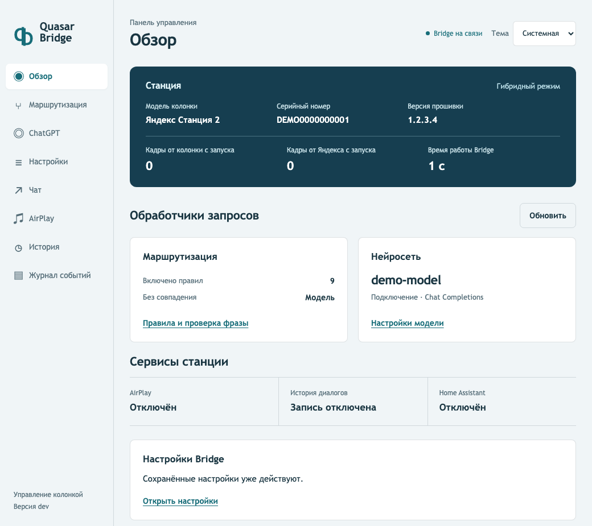
</picture>

<details>
<summary>Настройки Bridge и переходы к маршрутизации и ChatGPT</summary>

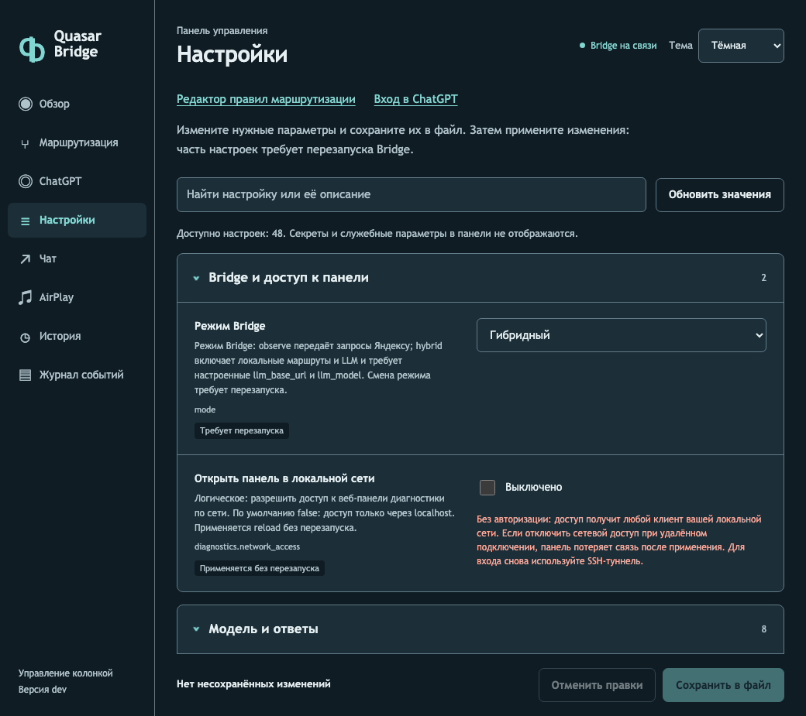

</details>

### Маршрутизация

В разделе **Маршрутизация** добавьте или откройте правило и настройте условия и обработчик. В блоке «Проверить это правило» введите пробную фразу и при необходимости ID слова активации. Кнопка «Проверить» покажет, подходят ли текущие условия, ещё до сохранения. Нажмите «Сохранить и применить», когда правило готово.

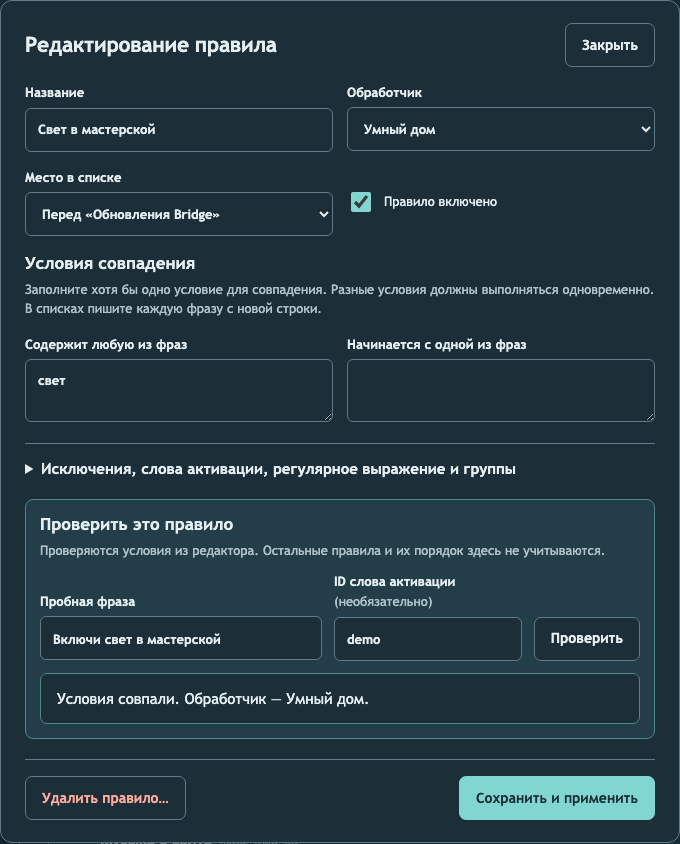

Чтобы проверить приоритет среди всех правил, воспользуйтесь блоком «Проверка фразы» на странице маршрутизации. Он показывает совпавшее правило для действующих и сохранённых настроек. Кнопка «Определить маршрут» дополнительно учитывает доступность обработчиков и при необходимости вызывает модель.

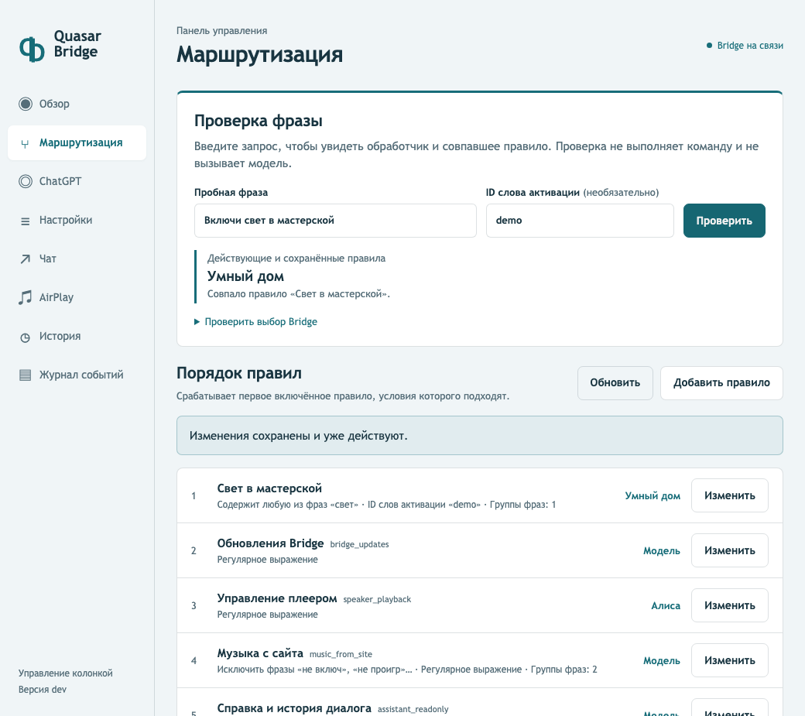

### Вход в ChatGPT и выбор модели

В разделе **ChatGPT** нажмите «Войти через ChatGPT» и подтвердите доступ в браузере. Если открыли панель через HTTP на localhost или 127.0.0.1, в том числе через SSH-туннель, браузер вернётся в панель автоматически. При подключении по адресу колонки вставьте в панель полный адрес возврата из вкладки ChatGPT. Bridge сохраняет токены в том же защищённом файле, что и CLI.

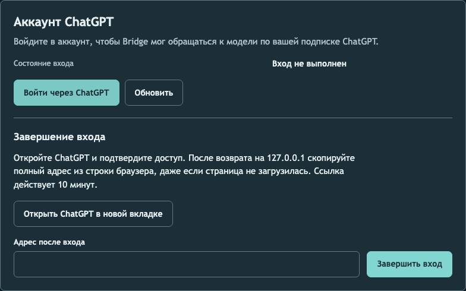

Когда для `llm_api` выбран `chatgpt`, откройте **ChatGPT → Модель Bridge** и нажмите «Обновить список», чтобы получить модели вашей подписки. При повторном открытии вкладка показывает последний загруженный список. После перезапуска Bridge или нового входа список нужно загрузить снова. Выберите модель и нажмите «Применить модель». Следующий запрос использует выбранную модель, и этот выбор сохраняется после перезапуска.

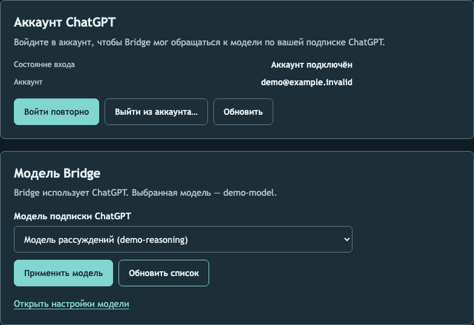

### Чат и история разговоров

В **Чате** можно задать текстовый вопрос и продолжить тот же диалог.

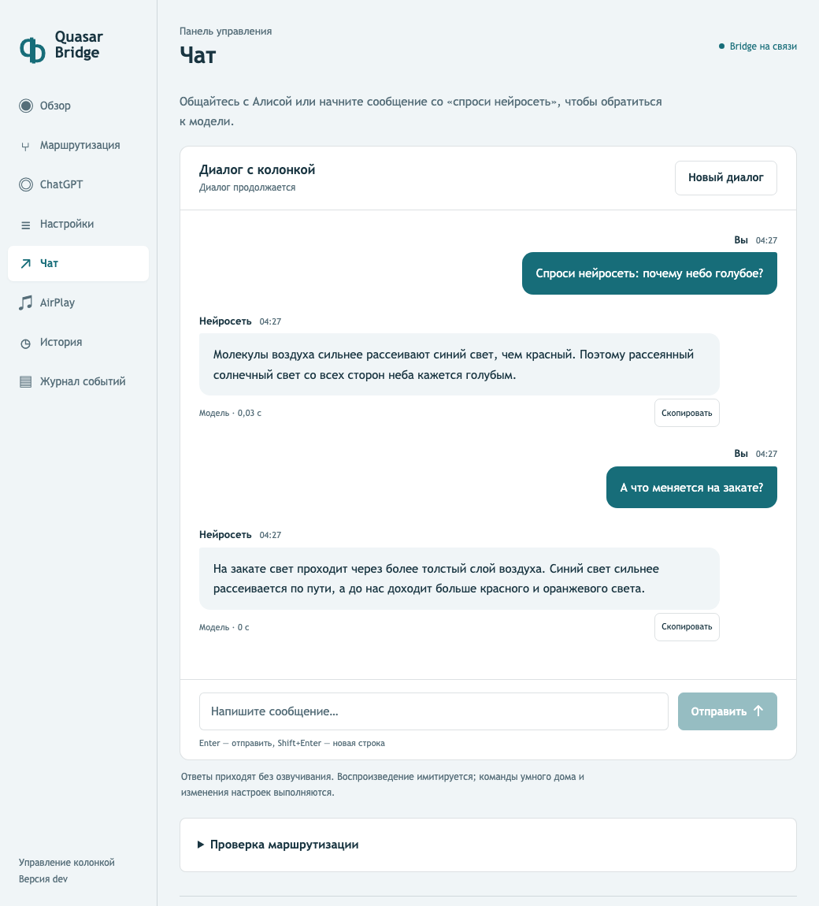

В **Истории** видны разговоры с колонкой по дням. Запросы расположены справа, ответы — слева. Можно найти фразу в вопросе или ответе и задать период поиска.

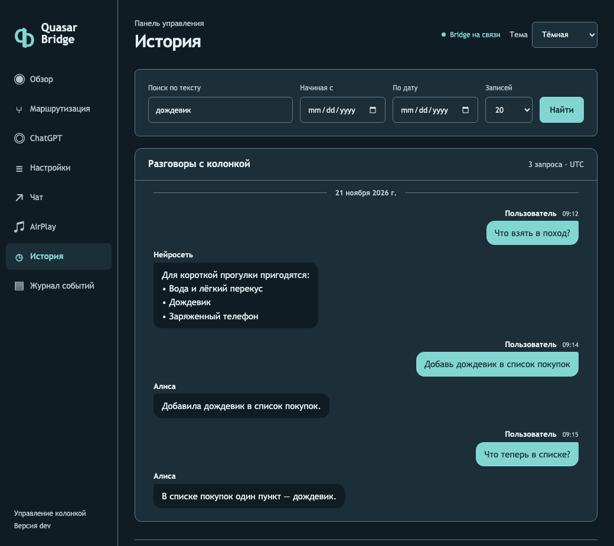

<details>
<summary>История на телефоне</summary>

На узком экране кнопка «Поиск и фильтры» открывает поля поиска над перепиской.

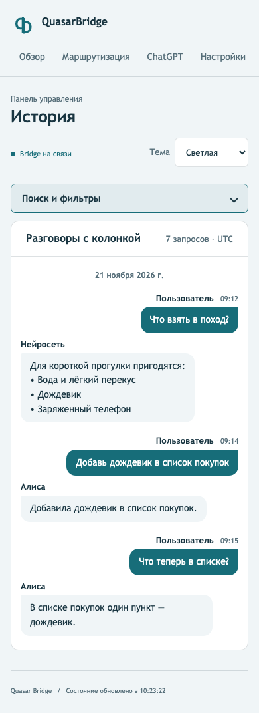

</details>

Снимки сделаны в демонстрационном экземпляре Bridge. Серийный номер, переписка, аккаунт и модели подписки на иллюстрациях тестовые.

## Что понадобится

- **Яндекс Станция с root-доступом по SSH.** Получить root нужно заранее —
  Quasar Bridge этого не делает.
- **Нейросеть с API, совместимым с OpenAI.** Подойдёт модель на вашем сервере
  или у любого провайдера. Понадобятся адрес API и, если сервис его требует,
  ключ. Установщик загрузит доступные модели и предложит выбрать одну из списка.
  Можно также [использовать подписку ChatGPT/Codex](https://github.com/skrashevich/quasar-bridge/wiki/Подписка-ChatGPT#подписка-chatgptcodex)
  через вход в ChatGPT, без ключа API. Саму модель Quasar Bridge не устанавливает.
- **Компьютер с `curl` и `ssh`.** В macOS и Linux всё уже есть, в Windows
  подойдёт WSL.
- **Home Assistant** — только если хотите управлять умным домом.

### На каких колонках проверено

| Колонка | Система |
| --- | --- |
| Станция 2 | Linux 4.9, BusyBox 1.31 |
| Станция Миди, в том числе сразу после получения root | Linux 5.4, BusyBox 1.36 |
| Станция Лайт | Linux 4.9, aarch64 |

На Станции 2 и Миди проверены установка, обновление и автозапуск после
перезагрузки, на Станции Лайт подтверждена работа.
Есть и сборка для 32-битных колонок (ARMv7), но конкретные модели
на ней не проверялись — после установки обязательно проверьте голосовые ответы.

### Демонстрации установки

В роликах установщик работает по SSH с эмулятором Станции 2
[КУЯСЭ](https://github.com/vypivshiy/kuyase). Он скачивает настоящий выпуск,
проверяет контрольные суммы, получает модели от нейросети и запускает Bridge
в гостевой прошивке. Перезагрузка отложена в конце установки.

<details>
<summary>Установка через API на Станцию 2 в КУЯСЭ</summary>

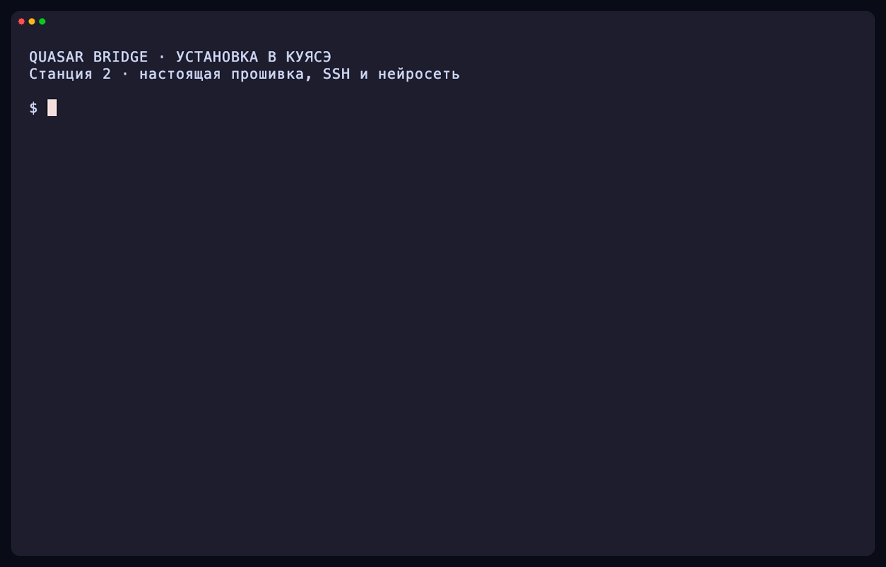

</details>

## Установка

Для установки Quasar Bridge на колонку достаточно стандартных утилит прошивки.
Для собственных слов активации в дополнение к штатным «Алиса» и «Яндекс»
отдельно установите и запустите на этой же Станции
[station-wakeword v0.4.0 или новее](https://github.com/tangenx/station-wakeword/releases/tag/v0.4.0).
[Установка и настройка station-wakeword](https://github.com/skrashevich/quasar-bridge/wiki/Слова-активации#правила-по-слову-активации)

**На компьютере** выполните команду, подставив адрес колонки вместо `SPEAKER_IP`:

```sh
curl -fsSL -o /tmp/install-quasar-bridge.sh https://github.com/skrashevich/quasar-bridge/releases/latest/download/install.sh && sh /tmp/install-quasar-bridge.sh root@SPEAKER_IP -p 2222
```

Если SSH на колонке слушает другой порт, замените `2222`.

Установщик сам скачает последнюю версию, сверит контрольную сумму, передаст
файлы на колонку и задаст несколько вопросов:

1. Адрес API нейросети (заканчивается на `/v1`) или `chatgpt` для подписки ChatGPT/Codex.
2. Ключ API — если не нужен, просто нажмите Enter. Ввод скрыт. Для `chatgpt` этот шаг пропускается.
3. Тип API: Chat Completions (подходит почти всем) или Responses. Для `chatgpt` он выбирается автоматически.
4. Номер модели из списка, загруженного через API. Для `chatgpt` перед этим потребуется вход в браузере.
5. Секретная ссылка на Home Assistant MCP — Enter, если умный дом не нужен.
   Ввод виден, чтобы можно было проверить и исправить адрес.

Для Chat Completions установщик автоматически подберёт совместимые параметры
запросов, если API отклоняет стандартные. При ошибках он покажет полный ответ
LLM-сервера и сохранит рабочие параметры для следующих запусков.

Затем он проверит, что нейросеть отвечает, предложит переключить Алису
на Quasar Bridge и перезагрузить колонку. Если что-то введено с ошибкой,
можно сразу исправить ответы. Автозапуск после перезагрузки настраивается
автоматически.

Для `chatgpt` установщик предложит войти в браузере. На компьютере нужно
открыть SSH-туннель для обратного вызова входа — готовую команду с адресом
колонки и портом установщик покажет сам. Дополнительные команды и ограничения режима
описаны в [инструкции подключения подписки](https://github.com/skrashevich/quasar-bridge/wiki/Подписка-ChatGPT#подписка-chatgptcodex).
Если список моделей получить не удалось или он пуст, установщик предложит
повторить настройку подключения либо отменить установку.

[Исходники роликов и команды перезаписи через VHS](scripts/vhs/README.md).

### Проверьте, что всё работает

Скажите колонке:

- «Алиса, какая завтра погода?» — должен ответить Яндекс;
- «Алиса, спроси нейросеть: почему небо голубое?» — должна ответить ваша модель.

Если оба ответа прозвучали — готово.

Программа живёт в `/data/opt/quasar-bridge/app`, а настройки —
в `/data/opt/quasar-bridge` (`config.json` и `runtime.env`).

## Обновление

Запустите ту же команду установки ещё раз. На вопрос об изменении настроек
нажмите Enter — всё сохранится. Установщик заменит программу, проверит,
что новая версия запустилась, а при ошибке вернёт прежнюю. Если Алиса уже
подключена к Quasar Bridge, перезагружать колонку не нужно.
При изменении подключения к нейросети URL Home Assistant сохраняется
и повторно не запрашивается.

<details>
<summary>Демонстрация обновления с сохранением настроек</summary>

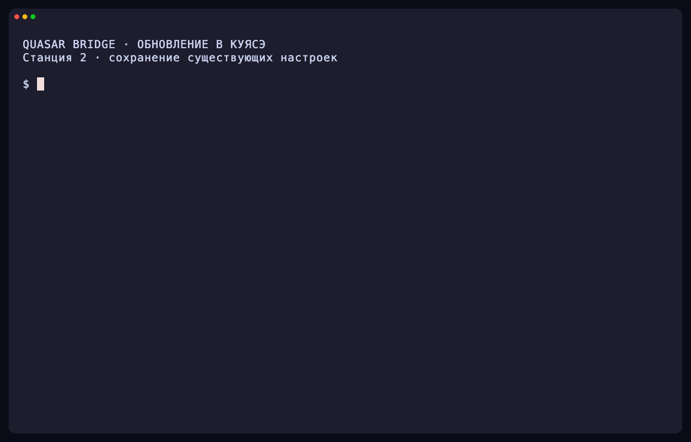

</details>

Обновляться можно и голосом — об этом ниже, в разделе
[«Дополнительные возможности»](#дополнительные-возможности).

## Подключение Home Assistant

Этот шаг нужен только для управления умным домом. Без Home Assistant
команды вроде «включи свет» по-прежнему выполняет Яндекс.

1. Установите MCP-сервер [ha-mcp](https://github.com/homeassistant-ai/ha-mcp)
   и включите доступ по секретной ссылке. Встроенный MCP-сервер Home Assistant
   не подойдёт: у него другой набор команд.
2. В Home Assistant откройте нужные устройства для **Assist** и проверьте,
   что у них понятные названия и указаны комнаты.
3. Укажите секретную ссылку. Проще всего — запустить команду установки ещё раз,
   ответить «y» на вопрос об изменении настроек и заново пройти все вопросы.
   Либо на колонке откройте `/data/opt/quasar-bridge/runtime.env`, впишите
   ссылку в строку `QUASAR_HOME_MCP_URL="..."` (символы `$`, `"` и `` ` ``
   экранируйте обратной косой чертой) и перезапустите программу:
   `sh /data/opt/quasar-bridge/app/control.sh restart`.

Попробуйте: «Алиса, горит ли свет в кабинете?» (подставьте свою комнату),
а потом включите и выключите одно устройство и убедитесь, что Home Assistant
это увидел.

Если Home Assistant недоступен, Алиса скажет об ошибке. Команда не будет
повторно отправлена Яндексу — устройство могло уже сработать, поэтому сначала
проверьте его состояние.

[Подробнее о настройке и требованиях к MCP-серверу](https://github.com/skrashevich/quasar-bridge/wiki/Home-Assistant#home-assistant-mcp).

## AirPlay

Скажите «Алиса, включи эйрплей», затем выберите колонку в списке AirPlay
на телефоне или компьютере в той же сети. «Алиса, выключи эйрплей»
останавливает приёмник, а «Алиса, статус эйрплей» проверяет его состояние.
После успешного включения AirPlay колонка произносит ответ и завершает
ожидание следующей команды, в том числе при запуске через инструмент нейросети.
Пока подключён отправитель, «пауза», «продолжи музыку», «стоп»,
«громче», «тише» и «громкость 5» управляют AirPlay. Переключение треков
зависит от поддержки удалённых команд отправителем.

В режиме `hybrid` эта функция доступна без дополнительных настроек:
приёмник запускается только по команде и после перезапуска Bridge снова
выключен. Для этих команд не нужны нейросеть, Home Assistant или инструменты;
распознавание и озвучивание по-прежнему выполняет Яндекс.
PCM-проигрыватель из `station-airplay` встроен в сам бинарник Bridge.
Для установки и обновления достаточно одного `quasar-bridge`; отдельный
проигрыватель или системный `aplay` устанавливать не нужно.
Для вывода звука используются штатная ALSA-библиотека и аудиоконфигурация колонки.
Нужен доступ колонки к локальной сети.

При `assistant_tools.enabled: true` нейросеть также получает инструменты
AirPlay: может проверить состояние, включить или выключить приёмник,
поставить воспроизведение на паузу, продолжить его, переключить трек
и изменить громкость. Например: «Алиса, спроси нейросеть, подключён ли
сейчас кто-нибудь по AirPlay». 
## Дополнительные возможности

Настройки Bridge можно менять голосом при включённых инструментах нейросети:
«Алиса, включи журнал диалогов квазар бридж», «Алиса, установи время хранения
контекста квазар бридж десять минут», «Алиса, перезапусти квазар бридж».
Изменения проверяются и сохраняются с резервной копией; настройки, которым нужен
перезапуск, применяются после отдельной явной команды. Перезапуск голосом
доступен для штатной установки на колонке.
[Подробнее о настройках голосом](https://github.com/skrashevich/quasar-bridge/wiki/Настройки-голосом#настройки-голосом).

Сразу после установки работают ответы нейросети, память разговора и, если
вы его подключили, умный дом. Остальное включается
в `/data/opt/quasar-bridge/config.json`.

Большинство функций ниже — это «инструменты», которыми нейросеть пользуется
сама. Чтобы их включить, добавьте в `config.json` блок (часовой пояс укажите свой;
не забудьте запятую после предыдущей настройки):

```json
"assistant_tools": {
  "enabled": true,
  "timezone": "Europe/Moscow"
}
```

и перезапустите программу:

```sh
sh /data/opt/quasar-bridge/app/control.sh restart
```

Модель должна уметь вызывать функции (function calling) — большинство
современных моделей это умеют.

| Что можно | Пример | Подробности |
| --- | --- | --- |
| Читать веб-страницы | «Алиса, прочитай страницу https://example.org и перескажи» | [Инструменты](https://github.com/skrashevich/quasar-bridge/wiki/Инструменты-LLM#инструменты-локальной-llm) |
| Проверять и ставить обновления | «Алиса, проверь обновления», «Алиса, установи обновления» | [Обновления](https://github.com/skrashevich/quasar-bridge/wiki/Обновления#проверка-и-установка-обновлений) |
| Искать в истории разговоров | «Алиса, найди в истории, что я спрашивал про свет». Нужно ещё включить журнал разговоров (`conversation_log`) | [Журнал](https://github.com/skrashevich/quasar-bridge/wiki/Журнал-диалогов#журнал-запросов-и-ответов) |
| Включать звуки и аудио по ссылке | «Алиса, спроси нейросеть: воспроизведи сигнал уведомления». Нужно добавить в блок `"play_sound": true` | [Звуки](https://github.com/skrashevich/quasar-bridge/wiki/Звуки-и-музыка#звуки-на-колонке) |
| Включать музыку с сайта | «Алиса, включи музыку с сайта example.org/music» — дальше работают «следующий трек», «пауза», «стоп». Тоже нужен `"play_sound": true` | [Звуки и музыка](https://github.com/skrashevich/quasar-bridge/wiki/Звуки-и-музыка#звуки-на-колонке) |
| Искать в интернете и подключать другие сервисы | Через сторонние MCP-серверы | [Свои MCP-серверы](https://github.com/skrashevich/quasar-bridge/wiki/Свои-MCP-серверы#свои-mcp-серверы) |
| Настраивать, что куда отправлять | Свои фразы для нейросети, Home Assistant и Яндекса | [Правила](https://github.com/skrashevich/quasar-bridge/wiki/Правила-маршрутизации#правила-маршрутизации) |

Учтите, что «прочитать страницу» и «поискать в интернете» — разные вещи:
первое работает из коробки, для второго нужен отдельный поисковый сервис.
Страницы, требующие входа или JavaScript, могут не открыться.

### О приватности

- Тексты разговоров по умолчанию **не сохраняются** на диск.
- Память разговора хранится в оперативной памяти и стирается при перезапуске.
- Если включить журнал, нейросеть сможет читать из него записи, когда вы
  спрашиваете про историю.
- Память у колонки общая: она не различает, кто именно с ней говорит.

## Если что-то не работает

Подключитесь к колонке по SSH и посмотрите, что происходит:

```sh
pkg=/data/opt/quasar-bridge/app
sh "$pkg/control.sh" status          # запущена ли программа
sh "$pkg/control.sh" logs            # последние строки журнала
sh "$pkg/control.sh" check           # корректны ли настройки
sh "$pkg/control.sh" check-backends  # доступны ли нейросеть и Home Assistant
```

| Что случилось | Что проверить |
| --- | --- |
| Алиса отвечает как обычно, нейросеть не включается | Согласились ли вы подключить Алису в конце установки и перезагрузили ли колонку? Если нет — выполните `sh "$pkg/control.sh" apply` и `reboot` |
| Проверка нейросети не проходит | Адрес API (с `/v1`), название модели, ключ и доступ к API с колонки. При ошибке HTTP 400 проверьте точное название модели и [совместимость API](https://github.com/skrashevich/quasar-bridge/wiki/Настройка-LLM#api-llm) |
| Home Assistant в проверке показан как `disabled` | Ссылка на MCP не задана. Если умный дом не нужен — всё в порядке |
| Устройство не находится | Открыто ли оно для Assist? Совпадают ли названия устройства и комнаты с тем, что вы говорите? |
| После перезагрузки Алиса замолчала | Есть ли файл `/etc/init.d/S96quasar-bridge`? Если быстро разобраться не получается, [верните Алису как было](#как-вернуть-всё-как-было) |

После изменения адреса, ключа или модели программу нужно перезапустить:
`sh "$pkg/control.sh" restart`.

Не получается разобраться — создайте
[issue](https://github.com/skrashevich/quasar-bridge/issues). Укажите модель
колонки, версию программы (файл `/data/opt/quasar-bridge/app/VERSION`), на каком шаге возникла проблема и текст ошибки.
Ключи API и секретные ссылки из `runtime.env` не публикуйте.

## Как вернуть всё как было

Если Bridge ещё работает в режиме `hybrid`, можно сказать: «Алиса, переведи
квазар бридж в режим наблюдения» — запросы будут идти в Яндекс через Bridge
после его перезапуска. Команда «Алиса, аварийный откат квазар бридж» планирует
восстановление прямого подключения к Яндексу и перезагрузку колонки.
Обе команды работают без LLM и при `assistant_tools.enabled: false` в
standalone-установке. Подробности и резервные копии — в [руководстве](https://github.com/skrashevich/quasar-bridge/wiki/Откат#откат).

**Порядок важен:** сначала верните Алисе прямое подключение к Яндексу и только
потом удаляйте программу. Иначе колонка будет обращаться к программе, которой
уже нет.

На колонке по SSH:

```sh
sh /data/opt/quasar-bridge/app/control.sh rollback && reboot
```

Убедитесь, что Алиса отвечает как раньше. Затем можно удалить программу
и её автозапуск:

```sh
sh /data/opt/quasar-bridge/app/uninstall.sh
```

Удаление не сработает, пока не выполнен `rollback`, — это защита от «немой»
колонки. Настройки, ключи и журналы остаются в `/data/opt/quasar-bridge`;
при желании удалите этот каталог вручную.

## Документация

- [Подробное руководство](https://github.com/skrashevich/quasar-bridge/wiki): запуск на отдельном сервере,
  сборка из исходников, все настройки и диагностика.
- [Пример настроек](config.example.json) и
  [пример с дополнительными MCP-серверами](config.mcp.example.json).
- [Как устроен проект](docs/design.md) и [результаты проверок](docs/validation.md).
- [E2E-проверки в КУЯСЭ](scripts/kuyase/README.md) охватывают голосовые сценарии и веб-панель
  в Chromium. На pull request проверяются пять профилей колонок с пакетами ARM64 и ARMv7.
- [Панель управления в браузере](https://github.com/skrashevich/quasar-bridge/wiki/Веб-панель#панель-управления-в-браузере):
  настройки, проверка запросов, AirPlay, история и журнал; сетевой доступ
  включается в конфиге или голосом, по умолчанию доступен только локалхост.
  Команды: «Алиса, включи веб-интерфейс» и «Алиса, выключи веб-интерфейс».

## Лицензия

[Apache License 2.0](LICENSE). Авторские права — в [NOTICE](NOTICE),
сторонние компоненты — в [THIRD_PARTY_NOTICES](THIRD_PARTY_NOTICES).
Встроенный AirPlay использует AAC-декодер `go-aac` под LGPL-3.0;
условия этого компонента также применяются при распространении бинарных сборок.
ALAC декодируется библиотекой `saprobe-alac` под Apache-2.0. Оба декодера
написаны на Go и собираются с `CGO_ENABLED=0`.
