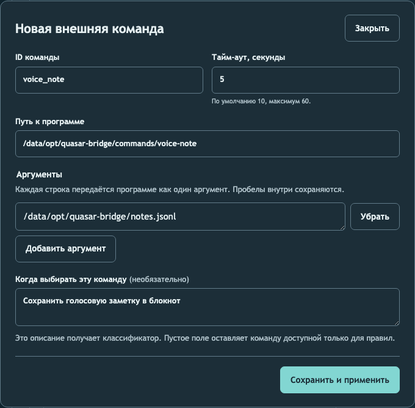
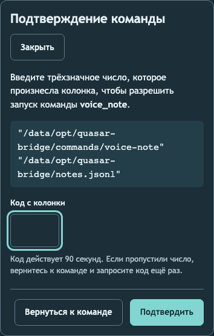

# Вызов внешней команды

В гибридном режиме фраза «Алиса, запиши заметку купить кофе» может запустить вашу программу и получить голосовой ответ «Заметка сохранена». Программа выполняется на устройстве, где работает Quasar Bridge, с правами его службы.

## Зарегистрировать программу

1. Выберите установленную на колонке программу. Для примера с заметками поместите [скрипт голосовых заметок](examples/voice-note) в `/data/opt/quasar-bridge/commands/voice-note` и сделайте его исполняемым командой `chmod 755 /data/opt/quasar-bridge/commands/voice-note`. Скрипту нужны штатные `/bin/sh`, `cat` и право записи в каталог с конфигурацией.
2. В веб-панели откройте **Маршрутизация → Внешние команды → Добавить команду**. Введите ID `voice_note` и абсолютный путь к скрипту.
3. Нажмите **Добавить аргумент** и введите `/data/opt/quasar-bridge/notes.jsonl`. Укажите тайм-аут `5` секунд. Чтобы разрешить выбор классификатором, заполните **Когда выбирать эту команду**, например «Сохранить голосовую заметку в блокнот».
4. Рядом с кнопкой **Получить код** появится предупреждение **Понадобится код с колонки**. Нажмите кнопку и послушайте, какое трёхзначное число дважды произнесёт Алиса. Проверьте путь и аргументы на экране, введите число в поле **Код с колонки** и нажмите **Подтвердить**. Команда сразу появится в редакторе правил.



Включите **Настройки → Открыть панель в локальной сети** и откройте панель по адресу колонки с телефона или компьютера. В форме можно указать любой абсолютный путь на устройстве с Bridge. Каждый аргумент передаётся буквально отдельным значением, включая строки с пробелами.

Код действует 90 секунд для одного изменения в том браузере, который его запросил. Bridge обращается к штатному речевому сервису колонки `aliced`. Алиса озвучивает всю фразу обычным голосом и с текущей громкостью колонки. Для этого нужны работающая Алиса и её подключение к Яндексу. При установке Bridge на отдельном сервере без локального `aliced` голосовое подтверждение недоступно. Если воспроизведение сорвалось, команда остаётся черновиком. Bridge исключает текст кода и связанный поток синтеза из веб-журнала. Код хранится в памяти Bridge до завершения проверки. Все операции с формой также проверяют сессионную cookie, CSRF-токен и источник запроса.



Если пропустили число, нажмите **Вернуться к команде** и снова нажмите **Получить код**. Между запросами неподтверждённого кода проходит минимум 30 секунд. Три неверных ввода за сутки приостанавливают подтверждения на 24 часа для всех браузеров. Смена IP или перезапуск Bridge сохраняют этот лимит.

Кнопка **Изменить** открывает ту же форму. Новый путь или аргументы требуют нового кода. При изменении только ID, описания для классификатора или тайм-аута используйте **Сохранить и применить**. При смене ID Bridge обновляет ссылки в правилах и описание классификатора. Перед удалением команды измените или удалите правила, которые её используют.

### Настройка через файл

Ту же команду можно добавить в объект `routing.commands` файла `config.json`. После ручного изменения в **Настройках** нажмите **Обновить значения**, затем **Применить без перезапуска** или отправьте Bridge сигнал `SIGHUP`.

```json
{
  "voice_note": {
    "path": "/data/opt/quasar-bridge/commands/voice-note",
    "args": ["/data/opt/quasar-bridge/notes.jsonl"],
    "timeout_ms": 5000
  }
}
```

`path` — абсолютный путь к программе. Каждый элемент `args` передаётся как отдельный аргумент, включая пробелы внутри него. Bridge запускает программу напрямую. Путь и аргументы задаёт владелец, а правило и модель выбирают программу по ID. ID может содержать до 64 латинских букв, цифр, точек, дефисов и подчёркиваний и начинается с буквы или цифры.

Скрипт добавляет весь полученный JSON в `notes.jsonl`, по одной строке на заметку. Для отдельного блокнота можно передать путь к файлу вида `notes-work.jsonl` в том же каталоге с конфигурацией. После успешной записи скрипт выводит «Заметка сохранена.». Если нужен только текст фразы и на устройстве есть Python 3, по тому же пути можно установить такой обработчик для фиксированного файла заметок.

```python
#!/usr/bin/env python3
import json
import sys
from pathlib import Path

request = json.load(sys.stdin)
target = Path(__file__).resolve().parent.parent / "notes.jsonl"
if target.is_symlink():
    sys.exit(1)
with target.open("a", encoding="utf-8") as notes:
    notes.write(json.dumps({"text": request["text"]}, ensure_ascii=False) + "\n")
print("Заметка сохранена.")
```

## Настроить выбор в веб-панели

- **По правилу.** В разделе **Маршрутизация** нажмите **Добавить правило**, выберите обработчик **Вызов команды** и команду `voice_note`. В поле **Начинается с одной из фраз** введите «запиши заметку». Проверьте пример и нажмите **Сохранить и применить**. Как и для других обработчиков, действует первое совпавшее включённое правило.
- **По решению классификатора.** В блоке **Если правила не подошли** включите **Поручить выбор обработчика модели**. В поле `voice_note` укажите «Пользователь просит сохранить голосовую заметку или добавить запись в блокнот» и нажмите **Применить настройки маршрута**. Теперь классификатор может выбрать эту команду и для фразы «Добавь в блокнот купить кофе». Пустое описание оставляет команду доступной только для правил.
- **Проверка.** «Проверка фразы» показывает ID при совпадении с правилом. «Определить маршрут» при необходимости обращается к классификатору и показывает его выбор. Обе проверки работают без запуска программы. Отправка сообщения в **Чате**, голосовой запрос и CLI-флаг `-query` действительно выполняют команду.

При ручной настройке добавьте такой объект в существующий массив `routing.rules`

```json
{"name":"notes","route":"command","command":"voice_note","match":{"starts_with_any":["запиши заметку"]}}
```

Для выбора моделью добавьте пару ID и описания в `routing.classifier.commands`. Bridge сам передаст этот список классификатору. Для команды ответ модели имеет вид `{"route":"command","command":"voice_note"}`. Если ID отсутствует в списке или ответ некорректен, применяется `routing.classifier.on_error`.

## Обмен через stdin и stdout

Bridge передаёт один JSON-объект в UTF-8, завершает его переводом строки и закрывает stdin. Пример для голосового запроса

```json
{"version":1,"text":"Запиши заметку купить кофе","command":"voice_note","source":"rule","rule":"notes","request_id":"request-17","input_type":"VoiceInput"}
```

| Поле | Значение |
| --- | --- |
| `version` | Версия формата, сейчас `1`. |
| `text` | Полный текст после распознавания или исходный текст сообщения. Регистр и фраза, по которой сработало правило, сохраняются. |
| `command`, `source` | ID команды и источник выбора, `rule` или `classifier`. |
| `rule` | Имя совпавшего правила. Передаётся при выборе по правилу. |
| `request_id`, `input_type` | Идентификатор запроса колонки и тип входного события, например `VoiceInput` или `TextInput`, когда они доступны. |
| `speaker_key`, `wake_word_tag` | Обезличенный ключ источника запроса и метка слова активации, если доступны. |

Завершите программу с кодом `0` и напечатайте в stdout готовый текст ответа в UTF-8 размером до 16 КиБ. Bridge уберёт пробельные символы по краям и передаст текст в штатный TTS Яндекса. Диагностические сообщения направляйте в stderr. Из окружения службы программе доступны `PATH`, `HOME`, `LANG`, `LC_ALL`, `TZ` и `TMPDIR`, если они заданы.

По умолчанию на выполнение даётся 10 секунд. В `timeout_ms` можно указать от 1 до 60 000 мс. При истечении времени или отмене запроса Bridge останавливает запущенную команду. Ненулевой код выхода, пустой или некорректный stdout и превышение лимита дают сообщение «Не удалось получить ответ от внешней команды». Автоматических повторов нет, поскольку программа уже могла совершить действие.

### Как найти причину ошибки

В **Журнале событий** введите ID команды в поле поиска. Успешный запуск получает запись с путём к программе, PID, источником выбора и именем правила, если оно сработало. Итоговая запись с той же меткой `request` показывает длительность, код выхода или сигнал и объёмы stdout и stderr. При сбое выберите уровень **Ошибки**. Поле `stage` показывает, удалось ли запустить процесс (`start`), чем закончилось выполнение (`wait`) или почему ответ не подходит для озвучивания (`stdout`).

При ошибке в журнал попадает текст диагностики из первых 2 КиБ stderr. Усечение отмечено полем `stderr_truncated`. Bridge маскирует известные значения аргументов, текст запроса и строки с признаками учётных данных. Пишите в stderr сообщения, которыми можно делиться с пользователями панели.

Например, сообщение оболочки `unterminated quoted string` с кодом выхода `2` означает незакрытую кавычку. Если программа запускается через `/bin/sh`, в форме укажите `-c` первым аргументом, а сам текст скрипта — вторым. Чтобы записать строку в файл и услышать подтверждение, вторым аргументом можно передать `echo 3 >> /tmp/test && echo Готово`. Последний `echo` печатает ответ для Алисы после успешной записи.
